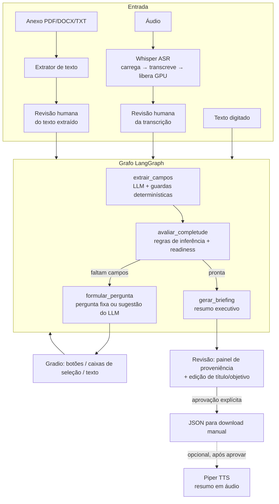

# DataBrief AI

Agente conversacional que transforma um pedido vago de dados ("preciso de um dashboard de matrículas") em um **briefing estruturado, revisado e aprovado por um humano**, pronto para entrar na lista de demandas do time.

Aceita texto, áudio (gravado ou enviado) e anexos (PDF, DOCX, TXT). Roda inteiro no Google Colab gratuito.

**Autor:** Philipe da Silva Simões — Coordenador de Dados, Gerência de Inteligência de Dados, YDUQS
**Contexto:** projeto final da pós-graduação em LLM & IA (PUC-Rio), 2026
**Versão atual:** `v1.0-final` (Ato 4) — ver [Histórico de releases](#histórico-de-releases)

---

## Sumário

1. [O problema](#o-problema)
2. [Como rodar em 5 passos](#como-rodar-em-5-passos)
3. [Como funciona](#como-funciona)
4. [Arquitetura](#arquitetura)
5. [Decisões técnicas](#decisões-técnicas)
6. [Avaliação](#avaliação)
7. [Limitações](#limitações)
8. [Política de dados](#política-de-dados)
9. [Transparência de IA](#transparência-de-ia)
10. [Próximos passos](#próximos-passos)
11. [Estrutura do repositório](#estrutura-do-repositório)
12. [Histórico de releases](#histórico-de-releases)
13. [Fontes técnicas](#fontes-técnicas)

---

## O problema

Num time de dados, boa parte do retrabalho nasce na entrada da demanda. O pedido chega por mensagem, áudio ou e-mail encaminhado, sem formato de entrega, sem pergunta de negócio e sem dizer se é algo pontual ou contínuo. O analista gasta a primeira reunião só descobrindo o que foi pedido.

| | |
|---|---|
| **Persona** | Coordenador ou analista sênior de dados que recebe demandas de áreas de negócio e precisa registrá-las num formato padrão (no caso da YDUQS, uma lista no SharePoint). Não há usuário leigo. |
| **Hipótese de valor** | Um agente que faz as perguntas certas, na ordem certa, e mostra de onde veio cada informação, reduz o tempo entre "chegou um pedido" e "temos um briefing aprovado" — sem tirar do humano a decisão final. |
| **O que ele faz** | Extrai os 7 campos do briefing do que o usuário disse, pergunta só o que falta, sugere perguntas de negócio, gera título e resumo, e exporta um JSON compatível com a lista do SharePoint. |
| **O que ele não faz** | Não executa a demanda, não acessa bases de dados, não envia nada a ninguém (o download é sempre manual) e não aprova sozinho. |

### Os 7 campos do briefing

| Campo | Como é resolvido |
|---|---|
| Tipo de demanda | Análise / Produto de Dados / Alarmística — extraído do texto ou escolhido em botões |
| Objetivo | Extraído do texto livre |
| Resultado esperado | Regra para Análise e Alarmística; escolha em botões para Produto de Dados (Dashboard / Tabela Gold / Agente) |
| Valor de negócio | Operacional / Tático / Estratégico — sempre escolhido em botões |
| Classificação estratégica | Até 3 de 8 categorias — extraída ou escolhida em caixas de seleção |
| Perguntas de negócio | Sugeridas pelo modelo, editadas e confirmadas pelo usuário |
| Título | Gerado pelo sistema no fim, editável antes de aprovar |

Bloqueios e link de evidência são opcionais e só entram quando o usuário os menciona.

---

## Como rodar em 5 passos

Funciona num runtime limpo do Colab. Tempo estimado: 5 minutos até a interface abrir.

**Antes de começar:** você precisa de uma conta Google e de um token de leitura do HuggingFace ([huggingface.co/settings/tokens](https://huggingface.co/settings/tokens)) — o token é uma senha que permite baixar o modelo Qwen.

1. **Abra o notebook no Colab.** Abra [`notebooks/DataBrief_AI.ipynb`](notebooks/DataBrief_AI.ipynb) e clique em "Open in Colab" (ou, no Colab, *Arquivo → Abrir notebook → GitHub* e cole a URL deste repositório).
2. **Ligue a GPU.** *Ambiente de execução → Alterar tipo de ambiente de execução → T4 GPU → Salvar.* Sem GPU disponível, use `MODO_EXECUCAO = "CPU_LOCAL"` no passo 4 (bem mais lento).
3. **Cadastre o token.** No menu lateral esquerdo, clique no ícone de chave (*Secrets*), adicione `HF_TOKEN` com o seu token e ative "Acesso ao notebook". Para o modo OpenAI, adicione também `OPENAI_API_KEY` no mesmo lugar.
4. **Rode tudo.** Confira `MODO_EXECUCAO` na Célula 1 (`"GPU_LOCAL"`, `"CPU_LOCAL"` ou `"OPENAI"`) e clique em *Ambiente de execução → Executar tudo*. A Célula 2 (carregar o modelo) é a mais lenta.
5. **Abra o link e teste.** A última célula imprime um link `https://....gradio.live`. Abra e digite, por exemplo:
   > *Preciso acompanhar a evolução da taxa de evasão do Digital mês a mês.*

   Responda às perguntas, revise o briefing, clique em **Aprovar e baixar briefing**.

**Para testar anexo e tratamento de erro:** a pasta [`docs/demo/`](docs/demo/) tem dois arquivos de exemplo. Envie `anexo_demo.txt` no campo de anexo para ver a extração com origem *anexo*. Envie `anexo_corrompido.pdf`, quebrado de propósito, para ver a mensagem de erro em vez de uma falha silenciosa.

> **Trocar de modo no meio da sessão:** mude `MODO_EXECUCAO` na Célula 1 e rode **todas** as células de novo. Só mudar a variável não basta — quem registra o modo ativo é a Célula 3.

**Rodar os testes automatizados** (não precisam de GPU nem de modelo), numa célula nova depois da Célula 1:

```python
!cd /content/databrief-ai && python -m pytest testes -q
```

(Ajuste o caminho se a Célula 1 clonar o repositório em outra pasta.)

---

## Como funciona

Uma conversa típica:

1. O usuário descreve a demanda (texto, áudio ou anexo).
2. Áudio e anexo passam por uma **tela de revisão**: o texto transcrito ou extraído aparece num campo editável antes de entrar na conversa — dá para corrigir uma sigla que o Whisper ouviu errado.
3. O agente extrai os campos que conseguir e **pergunta só o que falta**, um campo por vez. Campos com opções fixas aparecem como botões.
4. Quando tudo está preenchido, o agente gera título e resumo e mostra o **briefing com a origem de cada campo** (digitado, áudio, anexo, inferido pelo sistema, selecionado).
5. O usuário pode **editar título e objetivo**, depois aprova. Só então o JSON fica disponível para download e o botão de resumo em áudio aparece.

---

## Arquitetura



**Fluxo de dados.** Todo o estado da conversa vive num objeto Pydantic (`SessionState` → `DemandState`). A interface guarda esse estado como JSON entre um clique e outro e o reconstrói a cada evento; nenhum dado fica em variável global.

**Proveniência.** Cada campo de texto livre é um `FieldProvenance` (valor + origem + turno + arquivo + confirmado). Os três campos de opção fixa guardam o valor cru e registram a origem num dicionário ao lado (`proveniencia_campos_fixos`). Ao aprovar, todos são marcados `confirmado = True` e exportados em `_metadata.proveniencia`.

**Um único ponto de chamada ao modelo.** Todos os nós chamam `chamar_llm()`, que despacha para o Qwen local ou para a OpenAI conforme o modo registrado na inicialização.

| Componente | Arquivo | Papel |
|---|---|---|
| Schemas | `schemas/models.py` | `DemandState`, `FieldProvenance`, `TurnInput`, `ReadinessStatus`, `BriefingOutput` |
| Grafo | `graph/agent.py` | 4 nós, prompts, guardas anti-alucinação, regras de inferência |
| ASR | `audio/transcricao.py` | Whisper Small (GPU) ou Tiny (CPU), carga sob demanda |
| TTS | `audio/sintese.py` | Piper `pt_BR-edresson-low`, carga sob demanda |
| Anexos | `attachments/extracao.py` | pdfplumber, python-docx, TXT |
| Interface | `interface/app.py` | Gradio Blocks |
| Avaliação | `scripts/rodar_casos.py`, `scripts/avaliar.py` | Runner sem UI + 8 métricas + veredito humano |

---

## Decisões técnicas

**Por que LangGraph.** O fluxo é um ciclo com estado (extrair → avaliar → perguntar ou fechar) e não uma cadeia linear. O LangGraph modela isso como um grafo explícito de nós, e cada nó pode ser testado isoladamente. A mesma estrutura comportaria, no futuro, um nó de busca que o próprio agente decide quando acionar.

**Por que carga sequencial de modelos.** A T4 gratuita tem cerca de 15 GB de VRAM. Whisper e Qwen juntos não cabem com folga. O Whisper carrega, transcreve e libera a GPU antes do Qwen voltar a responder. O Piper roda em CPU e só carrega depois da aprovação. Esse padrão foi o primeiro teste do Ato 2, isolado, antes de qualquer integração.

**Por que 3 modos de execução.** A GPU gratuita do Colab não é garantida.

| Modo | LLM | ASR | Para quê |
|---|---|---|---|
| `GPU_LOCAL` | Qwen3-4B-Instruct, 4-bit | Whisper Small | Modo principal |
| `CPU_LOCAL` | Qwen3-1.7B, bf16 | Whisper Tiny | Contingência sem GPU |
| `OPENAI` | gpt-4o-mini via API | Whisper local | Alternativo, com chave institucional |

O modo é decidido uma vez, na inicialização, e **nunca troca sozinho**. Se o modo escolhido não tem o que precisa (sem GPU, sem chave), o sistema para com uma mensagem clara.

**Por que regras determinísticas em vez do LLM para campos de opção fixa.** Em testes reais, o Qwen errou `valor_negocio` 3 de 3 vezes, nos dois tamanhos de modelo, confundindo "Tático" com "Operacional" quando o texto dizia "eficiência operacional". Campos com poucas opções conhecidas viraram botões. O modelo fica com o que só ele faz bem: entender texto livre.

**Por que guardas anti-alucinação.** O modelo preenchia campos sem base no texto (título inventado, tipo de demanda chutado a partir de "segue o anexo"). Cada guarda confere o texto original do usuário, não a resposta do modelo. Exemplo: o resultado esperado só é aceito se o texto contiver uma palavra de formato ("dashboard", "alerta"…).

**Por que o RAG foi testado e removido.** Um pipeline com embeddings E5-small e índice FAISS foi implementado e testado com um corpus real da YDUQS: 54 trechos, sendo 28 páginas da apresentação corporativa e 26 seções do site institucional. A intenção era que o agente conhecesse melhor a empresa para fazer perguntas mais específicas ao solicitante. Na prática, o modelo recuperava os cinco trechos mais parecidos com a demanda e os citava no briefing, em vez de usá-los para perguntar melhor. Em três demandas de teste, uma recebeu uma citação útil; outra, trechos quase repetidos de uma mesma página de gráfico; e a terceira, sobre consumo de energia de data centers, recebeu quatro trechos sem relação com o pedido, apresentados como relevantes.

Com a stack do projeto, o RAG não funcionou bem: um modelo local de 4 bilhões de parâmetros, decidindo sozinho o que era relevante, não teve capacidade para separar o trecho útil do irrelevante. Ao mesmo tempo, o agente já entregava briefings completos sem ele, porque o que falta numa demanda vaga vem das perguntas ao solicitante. Mantê-lo só acrescentaria risco de ruído no briefing, então seguimos sem ele. O código e os testes ficaram preservados no histórico do repositório.

**Por que três tipos de demanda, não quatro.** "Estruturante" (pipeline, tabela Gold) saiu como tipo: na prática sempre servia de base para um Produto de Dados ou uma Alarmística. Continua existindo como classificação estratégica.

---

## Avaliação

### Dataset

**10 casos sintéticos** em `testes/casos_teste.py`, cobrindo 10 categorias de situação: tema sem formato, formato explícito, bloqueio e link, alerta explícito, pergunta de negócio, caso fechado, anexo, ambiguidade, áudio e demanda totalmente vaga. As demandas são inventadas, mas o vocabulário é real da YDUQS (marcas, modalidades, métricas). Cada caso tem respostas previstas por campo e um gabarito final.

O plano inicial previa 50 casos; escolhemos 10 para caber no tempo disponível do projeto, um por categoria. A ampliação está nos [Próximos passos](#próximos-passos).

### Como foi medido

`scripts/avaliar.py` roda cada caso até o briefing ficar pronto, simulando as respostas do usuário. Calcula as métricas automáticas e gera um CSV para **veredito humano** dos campos de texto livre (título, objetivo, perguntas de negócio): 27 itens por modo, cada um marcado "concordo" ou "discordo".

### Resultados — qualidade

| Métrica | Meta | GPU_LOCAL | OPENAI |
|---|---|---|---|
| F1 tipo de demanda | — | 0,90 | 1,00 |
| F1 valor de negócio | — | 1,00 | 1,00 |
| F1 classificação estratégica | — | 0,817 | 0,967 |
| F1 resultado esperado | — | 0,90 | 1,00 |
| Recall de lacunas | ≥ 0,90 | 1,00 | 1,00 |
| Perguntas repetidas | 0 | 0 | 0 |
| Perguntas desnecessárias | ≤ 15% | 0% | 0% |
| Turnos até pronta (média) | — | 3,4 | 4,1 |
| Completude média | ≥ 0,85 | 1,00 | 1,00 |
| Concordância humana | ≥ 0,80 | **0,704** (19/27) | 0,815 (22/27) |

Fonte: `resultados/avaliacoes/GPU_LOCAL_20260907_184439_final.json` e `OPENAI_20260912_191116_final.json`.

### Resultados — latência

| Modo | Lote de 10 casos | Extração P50 / P95 | Geração do briefing P50 |
|---|---|---|---|
| CPU_LOCAL | 63,2 min | 247,5 s / 276,0 s | 190,4 s (n=1) |
| GPU_LOCAL | 3,6 min | 8,3 s / 16,7 s | 22,3 s |
| OPENAI | ~1 min | 1,0 s / 1,3 s | 2,1 s |

CPU_LOCAL e a primeira linha de GPU_LOCAL vêm dos baselines de `resultados/execucoes/` (30/08). A coluna do briefing de GPU_LOCAL e a linha OPENAI vêm das rodadas de avaliação.

### Conclusões

- **OPENAI bate todas as metas numéricas.** É também o mais rápido, por não disputar a GPU gratuita nem carregar modelo.
- **GPU_LOCAL bate todas as metas automáticas e fica abaixo só na concordância humana.** A causa principal são títulos vagos nos casos C006 a C010: o modelo de 4B resume demais nomes próprios e recortes ("Monitoramento de renovação Ibmec" em vez de nomear a praça de São Paulo). Por isso o título agora é **editável antes de aprovar** (Ato 4).
- **As metas de processo foram atingidas nos dois modos avaliados:** nenhuma pergunta repetida, nenhuma desnecessária, nenhuma lacuna esquecida.
- **CPU_LOCAL funciona de ponta a ponta**, mas a qualidade não foi medida formalmente.

### Recuperação de falhas

Cenários de erro deliberados, catalogados no Ato 3:

| Cenário | Tratamento | Como foi validado |
|---|---|---|
| Anexo corrompido ou protegido | Mensagem de erro na tela (corrigido no Bloco 29) | Código + teste |
| Áudio sem fala ou ilegível | Mensagem específica (corrigido no Bloco 29) | Código + teste |
| Chave OpenAI ausente ou inválida | Erro claro, sem trocar de modelo | Ao vivo (erro 401 exibido) |
| Modo passado sem o tipo certo | Erro na inicialização (Bloco 15) | Teste automatizado |
| GPU indisponível com `GPU_LOCAL` | Célula 1 para com instrução | Manual, só no notebook |
| Backend de quantização ausente | Célula 2 para com instrução | Manual, só no notebook |

Os 6 cenários terminam com mensagem clara ao usuário, nenhum com falha silenciosa. Não calculamos uma taxa formal: dois cenários existem só no notebook e não são automatizáveis neste repositório.

---

## Limitações

O que **não** foi feito, ou foi simplificado, e por quê:

- **Concordância humana com um único avaliador** (o autor), sem rubrica calibrada nem segundo avaliador.
- **Avaliação de qualidade do CPU_LOCAL.** Devido ao tempo disponível, a avaliação de qualidade não foi feita nesse modo: um ciclo completo levaria de 60 a 90 minutos de execução, mais a revisão humana. Isso não afeta as conclusões, porque o CPU_LOCAL é a contingência para quando não há GPU. A qualidade foi medida nos dois modos de uso principal, e o CPU_LOCAL rodou os 10 casos de ponta a ponta, sem erro, com a latência medida.
- **Completude 1,0 é parcialmente efeito do método.** O avaliador fornece respostas previstas para todo campo perguntado, então todo caso chega a "pronto". A métrica mostra que o fluxo fecha, não que um usuário real responderia tudo.
- **Casos de falha sem teste formal para os cenários de notebook** (GPU e quantização).
- **Campos específicos por tipo não existem.** Uma Alarmística não registra limite de alerta nem frequência; uma Análise não registra recorte temporal. O schema previsto nunca foi ligado ao grafo e foi removido no Ato 4 para não fingir que existia.
- **Uma demanda por sessão.** O desmembramento automático (ex.: "precisa de uma tabela Gold antes do dashboard") foi desenhado no Ato 1 e nunca ativado.
- **Sem persistência no Google Drive.** O plano previa salvar briefings e índice no Drive. Com a remoção do RAG, ficou só o download manual do JSON; a sessão do Colab some ao desconectar.
- **Variabilidade do modelo local.** O mesmo caso pode fechar em 3 turnos numa rodada e travar noutra (C006 em GPU_LOCAL). Geração não determinística.
- **Link público temporário.** O Gradio no Colab gera um link aberto. Há aviso na tela, mas não há autenticação.

---

## Política de dados

- **Só dados fictícios.** Todas as demandas de teste são inventadas. Nenhum dado de aluno, colaborador ou cliente foi usado.
- **Sem PII no repositório.** Nenhum arquivo versionado contém dados pessoais.
- **Chaves nunca no código.** `HF_TOKEN` e `OPENAI_API_KEY` vêm dos *Secrets* do Colab (ou `getpass`), nunca de uma célula ou commit.
- **Nada sai sozinho.** O sistema não envia e-mail, não grava em SharePoint, não chama nenhum serviço além do modelo escolhido. O briefing só existe fora do Colab se o usuário clicar em download.
- **No modo OPENAI, o texto da conversa vai para a API da OpenAI.** Nos modos locais, nada sai da máquina do Colab.

---

## Transparência de IA

| Etapa | Automatizado | Humano |
|---|---|---|
| Transcrição de áudio | Whisper | Revisa e corrige antes de enviar |
| Texto de anexo | Extrator | Revisa e limpa antes de enviar |
| Extração de campos | LLM + guardas por regra | Vê a origem de cada campo |
| Tipo, valor, classificação, formato | — | Escolhe em botões (quando não está explícito) |
| Perguntas de negócio | LLM sugere | Edita e confirma |
| Título e resumo | LLM gera | Pode editar o título antes de aprovar |
| Aprovação | — | **Sempre humana** |
| Envio | — | **Sempre download manual** |
| Resumo em áudio | Piper TTS | Só depois da aprovação; rotulado como voz sintética |

O briefing na tela e o JSON exportado trazem um aviso de que o conteúdo foi estruturado com apoio de IA, com o modelo usado. O player de áudio é rotulado como voz gerada por IA.

---

## Próximos passos

Em ordem de prioridade:

1. **Ampliar o dataset para 50 casos e incluir um segundo avaliador.** É o que mais aumenta a confiança nos números; hoje cada caso pesa 10%.
2. **Corpus e taxonomia reais da YDUQS (Camada 2).** O RAG com corpus público não ajudou; um corpus interno — catálogo de tabelas Gold, dashboards existentes, faróis — pode ajudar de verdade a evitar demandas duplicadas. Para implementar: reaproveitar o pipeline E5-small + FAISS removido no Ato 2 (código no histórico do Git, antes da tag `v0.2-ato2`), indexar o catálogo interno e acionar a busca só em demandas não sensíveis.
3. **Campos específicos por tipo**, começando por Alarmística (indicador, limite, frequência, destinatários) — é onde um briefing incompleto custa mais.
4. **Avaliação de qualidade do CPU_LOCAL**, para saber se a contingência é utilizável de verdade.
5. **Rubrica calibrada para demandas YDUQS** e exemplos de briefings reais anonimizados como referência para o modelo.
6. **Fluxo multi-demanda** (desmembrar e ordenar por dependência técnica).
7. **Persistência no Drive** e histórico de briefings da sessão.
8. **Integração com Jira / Azure DevOps / SharePoint**, hospedagem permanente e autenticação — só depois que os itens acima mostrarem valor em uso real.

---

## Estrutura do repositório

```
databrief-ai/
├── schemas/models.py          # Schemas Pydantic
├── graph/agent.py             # Grafo LangGraph, prompts, regras
├── audio/
│   ├── transcricao.py         # Whisper (ASR)
│   └── sintese.py             # Piper (TTS)
├── attachments/extracao.py    # PDF / DOCX / TXT
├── interface/app.py           # Gradio Blocks
├── testes/
│   ├── casos_teste.py         # 10 casos de avaliação (dados, não testes pytest)
│   ├── conftest.py            # configuração do pytest
│   ├── test_schemas_e_agente.py
│   └── test_interface.py
├── scripts/
│   ├── rodar_casos.py         # roda os casos sem interface, mede latência
│   └── avaliar.py             # 8 métricas + veredito humano
├── resultados/
│   ├── execucoes/             # baselines de latência por modo
│   └── avaliacoes/            # relatórios, vereditos e resultados finais
├── notebooks/DataBrief_AI.ipynb
├── docs/demo/                 # arquivos de exemplo para testar (inclui um PDF quebrado de propósito)
└── requirements.txt
```

---

## Histórico de releases

| Tag | Entrega |
|---|---|
| `v0.1-texto` | Ato 1 — schemas, grafo LangGraph só com texto, Gradio básico, briefing aprovável |
| `v0.2-ato2` | Ato 2 — Whisper com revisão de transcrição, anexos, proveniência por origem, Piper TTS; RAG implementado, testado e removido |
| `v0.3-ato3` | Ato 3 — 3 modos selecionáveis sem fallback silencioso, 10 casos, script com 8 métricas, veredito humano, 2 casos de falha corrigidos |
| `v1.0-final` | Ato 4 — proveniência dos 3 campos de opção fixa, schema morto removido, edição de título/objetivo antes de aprovar, aviso de link público, rótulo de IA, "Novo caso" que limpa a tela inteira, 17 testes automáticos, README completo |

---

## Fontes técnicas

Consultadas entre agosto e outubro de 2026.

- Qwen Team. *Qwen3 Technical Report.* Alibaba, 2025. Modelos Qwen3-4B-Instruct e Qwen3-1.7B, via HuggingFace.
- Radford, A. et al. *Robust Speech Recognition via Large-Scale Weak Supervision* (Whisper). OpenAI, 2022.
- Dettmers, T. et al. *QLoRA: Efficient Finetuning of Quantized LLMs.* NeurIPS, 2023 — base da quantização 4-bit do bitsandbytes.
- LangChain. *LangGraph documentation* — langchain-ai.github.io/langgraph.
- Gradio. *Gradio Blocks documentation* — gradio.app/docs.
- Pydantic. *Pydantic v2 documentation* — docs.pydantic.dev.
- Rhasspy. *Piper TTS* e catálogo `rhasspy/piper-voices` — voz `pt_BR-edresson-low`, treinada no TTS-Portuguese-Corpus.
- Wang, L. et al. *Multilingual E5 Text Embeddings* (2024) — usado no RAG removido no Ato 2.
- OpenAI. *gpt-4o-mini* — platform.openai.com/docs.
- YDUQS. *Apresentação Corporativa*, junho de 2026 — fonte do vocabulário de negócio dos casos de teste.
