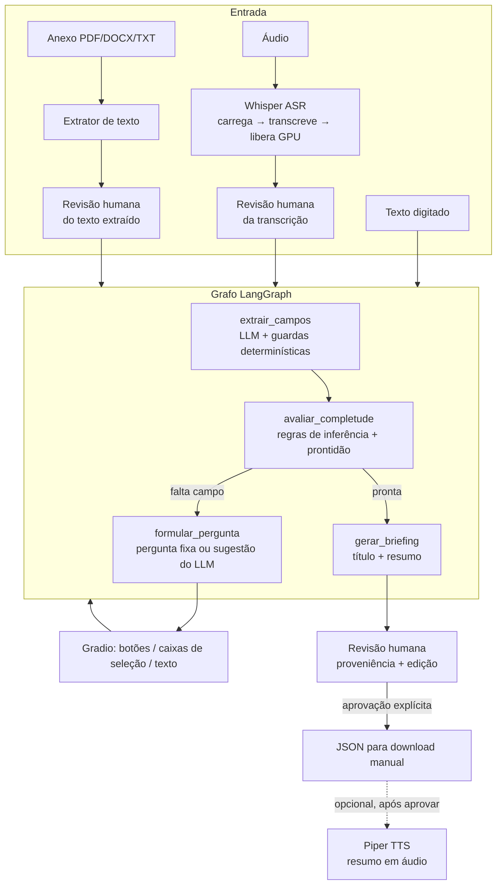

# DataBrief AI: um agente conversacional multimodal para refinamento de demandas de dados

#### Aluno: [Philipe da Silva Simões](https://github.com/philsimoes)
#### Orientador: [Leonardo Alfredo Forero Mendoza](https://github.com/leofome8)

---

Trabalho apresentado ao curso [GenAI e LLM MASTER](https://ica.ele.puc-rio.br/cursos/ia-generativa-large-language-models/) como pré-requisito para conclusão de curso e obtenção de crédito na disciplina "Projetos de Sistemas Inteligentes de Apoio à Decisão".

- [Link para o código](notebooks/DataBrief_AI.ipynb).

- [Link para a monografia](docs/DataBrief_AI_Texto_Academico.pdf).

---

### Resumo

Este trabalho apresenta o DataBrief AI, um agente conversacional que transforma pedidos vagos de dados em briefings estruturados, revisados e aprovados por um humano. O agente aceita texto, áudio e anexos, roda no Google Colab gratuito e oferece três modos de execução: um modelo local de 4 bilhões de parâmetros em GPU, um modelo local menor em CPU e uma API comercial.

A arquitetura combina um grafo de estados (LangGraph), extração de campos por modelo de linguagem, guardas determinísticas contra alucinação e um registro de proveniência por campo. Avaliado em 10 casos sintéticos, o agente atingiu todas as metas de processo nos dois modos avaliados por completo: recall de lacunas de 1,00, nenhuma pergunta repetida ou desnecessária e completude de 1,00.

A concordância humana foi de 0,815 com gpt-4o-mini e de 0,704 com Qwen3-4B local, abaixo da meta de 0,80. A diferença se concentra em títulos gerados de forma vaga pelo modelo menor, o que motivou tornar o título editável antes da aprovação.

### Abstract

This work presents DataBrief AI, a conversational agent that turns vague data requests into structured briefs, reviewed and approved by a human. The agent accepts text, audio and attachments, runs on the free tier of Google Colab and offers three execution modes: a local 4-billion-parameter model on GPU, a smaller local model on CPU and a commercial API.

The architecture combines a state graph (LangGraph), field extraction by a language model, deterministic guards against hallucination and a per-field provenance record. Evaluated on 10 synthetic cases, the agent met every process target in the two fully evaluated modes: gap recall of 1.00, no repeated or unnecessary questions and completeness of 1.00.

Human agreement was 0.815 with gpt-4o-mini and 0.704 with local Qwen3-4B, below the 0.80 target. The gap is concentrated in vague titles generated by the smaller model, which led to making the title editable before approval.

### 1. Introdução

Num time de dados, boa parte do retrabalho nasce na entrada da demanda. O pedido chega por mensagem, áudio ou e-mail encaminhado, sem formato de entrega, sem pergunta de negócio e sem dizer se é algo pontual ou contínuo. O analista gasta a primeira reunião só descobrindo o que foi pedido.

O contexto deste trabalho é a Gerência de Inteligência de Dados da YDUQS, holding de ensino superior com marcas como Estácio, Wyden e Ibmec, que registra demandas numa lista padronizada do SharePoint.

| | |
|---|---|
| **Persona** | Coordenador ou analista sênior de dados que recebe demandas de áreas de negócio e precisa registrá-las num formato padrão. Não há usuário leigo. |
| **Hipótese de valor** | Um agente que faz as perguntas certas, na ordem certa, e mostra de onde veio cada informação, reduz o tempo entre "chegou um pedido" e "temos um briefing aprovado", sem tirar do humano a decisão final. |
| **O que ele faz** | Extrai os 7 campos do briefing do que o usuário disse, pergunta só o que falta, sugere perguntas de negócio, gera título e resumo e exporta um JSON compatível com a lista do SharePoint. |
| **O que ele não faz** | Não executa a demanda, não acessa bases de dados, não envia nada a ninguém (o download é sempre manual) e não aprova sozinho. |

**Restrições de projeto:** execução no Google Colab gratuito, onde a GPU T4 não é garantida e tem cerca de 15 GB de memória; uso preferencial de modelos abertos e locais; aprovação humana obrigatória antes de qualquer saída; nenhum envio automático.

### 2. Modelagem

#### 2.1 Os 7 campos do briefing

| Campo | Como é resolvido |
|---|---|
| Tipo de demanda | Análise / Produto de Dados / Alarmística, extraído do texto ou escolhido em botões |
| Objetivo | Extraído do texto livre |
| Resultado esperado | Regra para Análise e Alarmística; escolha em botões para Produto de Dados (Dashboard / Tabela Gold / Agente) |
| Valor de negócio | Operacional / Tático / Estratégico, sempre escolhido em botões |
| Classificação estratégica | Até 3 de 8 categorias, extraída ou escolhida em caixas de seleção |
| Perguntas de negócio | Sugeridas pelo modelo, editadas e confirmadas pelo usuário |
| Título | Gerado pelo sistema no fim, editável antes de aprovar |

Bloqueios e link de evidência são opcionais e só entram quando o usuário os menciona.

#### 2.2 Fluxo da conversa

1. O usuário descreve a demanda por texto, áudio ou anexo (PDF, DOCX ou TXT).
2. Áudio e anexo passam por uma **tela de revisão**: o texto transcrito ou extraído fica editável antes de entrar na conversa, o que permite corrigir uma sigla mal reconhecida.
3. O agente extrai os campos que conseguir e **pergunta só o que falta**, um campo por vez. Campos de opções fixas aparecem como botões.
4. Completo o estado, o agente gera título e resumo e exibe o **briefing com a origem de cada campo**: digitado, áudio, anexo, inferido pelo sistema ou selecionado.
5. O usuário pode **editar título e objetivo** e então aprova. Só depois disso o JSON fica disponível para download e o resumo em áudio pode ser gerado.

#### 2.3 Arquitetura



**Estado.** Todo o estado da conversa vive em objetos Pydantic (`SessionState` → `DemandState`). A interface guarda esse estado como JSON entre um clique e outro e o reconstrói a cada evento; nenhum dado fica em variável global.

**Proveniência.** Cada campo de texto livre é um `FieldProvenance` (valor, origem, turno, arquivo, confirmado). Os três campos de opção fixa guardam o valor cru e registram a origem num dicionário ao lado (`proveniencia_campos_fixos`). Ao aprovar, todos são marcados como confirmados e exportados em `_metadata.proveniencia`.

**Um único ponto de chamada ao modelo.** Todos os nós chamam `chamar_llm()`, que despacha para o Qwen local ou para a OpenAI conforme o modo registrado na inicialização.

| Componente | Arquivo | Papel |
|---|---|---|
| Schemas | `schemas/models.py` | `DemandState`, `FieldProvenance`, `TurnInput`, `ReadinessStatus`, `BriefingOutput` |
| Grafo | `graph/agent.py` | 4 nós, prompts, guardas anti-alucinação, regras de inferência |
| ASR | `audio/transcricao.py` | Whisper Small (GPU) ou Tiny (CPU), carga sob demanda |
| TTS | `audio/sintese.py` | Piper `pt_BR-edresson-low`, carga sob demanda |
| Anexos | `attachments/extracao.py` | pdfplumber, python-docx, TXT |
| Interface | `interface/app.py` | Gradio Blocks |
| Avaliação | `scripts/rodar_casos.py`, `scripts/avaliar.py` | Execução sem interface, 8 métricas e veredito humano |

#### 2.4 Decisões técnicas

**Por que LangGraph.** O fluxo é um ciclo com estado (extrair → avaliar → perguntar ou fechar), e não uma cadeia linear. O LangGraph modela isso como um grafo explícito de nós, e cada nó pode ser testado isoladamente. A mesma estrutura comportaria, no futuro, um nó de busca que o próprio agente decide quando acionar.

**Por que carga sequencial de modelos.** A T4 gratuita tem cerca de 15 GB de memória de vídeo, e Whisper e Qwen juntos não cabem com folga. O Whisper carrega, transcreve e libera a GPU antes de o Qwen voltar a responder. O Piper roda em CPU e só carrega depois da aprovação.

**Por que três modos de execução.** A GPU gratuita do Colab não é garantida.

| Modo | Modelo de linguagem | Reconhecimento de fala | Papel |
|---|---|---|---|
| `GPU_LOCAL` | Qwen3-4B-Instruct, 4 bits | Whisper Small | Modo principal |
| `CPU_LOCAL` | Qwen3-1.7B, bf16 | Whisper Tiny | Contingência sem GPU |
| `OPENAI` | gpt-4o-mini via API | Whisper local | Alternativo, com chave institucional |

O modo é decidido uma vez, na inicialização, e **nunca troca sozinho**. Se o modo escolhido não tem o que precisa (sem GPU, sem chave), o sistema para com uma mensagem clara.

**Por que regras determinísticas para campos de opção fixa.** Em testes reais, o Qwen errou o valor de negócio 3 de 3 vezes, nos dois tamanhos de modelo, confundindo "Tático" com "Operacional" quando o texto dizia "eficiência operacional". Campos com poucas opções conhecidas viraram botões. O modelo fica com o que só ele faz bem: interpretar texto livre.

**Por que guardas contra alucinação.** O modelo preenchia campos sem base no texto, como um título inventado ou um tipo de demanda chutado a partir de "segue o anexo". Cada guarda confere o texto original do usuário, e não a resposta do modelo. Por exemplo, o resultado esperado só é aceito se o texto contiver uma palavra de formato, como "dashboard" ou "alerta".

**Por que o RAG foi testado e removido.** Um pipeline com embeddings E5-small e índice FAISS foi implementado e testado com um corpus real da YDUQS: 54 trechos, sendo 28 páginas da apresentação corporativa e 26 seções do site institucional. A intenção era que o agente conhecesse melhor a empresa para fazer perguntas mais específicas ao solicitante. Na prática, o modelo recuperava os cinco trechos mais parecidos com a demanda e os citava no briefing, em vez de usá-los para perguntar melhor. Em três demandas de teste, uma recebeu uma citação útil; outra, trechos quase repetidos de uma mesma página de gráfico; e a terceira, sobre consumo de energia de data centers, recebeu quatro trechos sem relação com o pedido, apresentados como relevantes.

Com a stack do projeto, o RAG não funcionou bem: um modelo local de 4 bilhões de parâmetros, decidindo sozinho o que era relevante, não teve capacidade para separar o trecho útil do irrelevante. Ao mesmo tempo, o agente já entregava briefings completos sem ele, porque o que falta numa demanda vaga vem das perguntas ao solicitante. Mantê-lo só acrescentaria risco de ruído no briefing, então seguimos sem ele. O código e os testes ficaram preservados no histórico do repositório.

**Por que três tipos de demanda, e não quatro.** A categoria "Estruturante" (pipeline, tabela Gold) sempre servia de base para um Produto de Dados ou uma Alarmística, nunca era o pedido final de uma área de negócio. Passou a existir só como classificação estratégica.

#### 2.5 Política de dados e transparência de IA

- **Só dados fictícios.** Todas as demandas de teste são inventadas; nenhum dado de aluno, colaborador ou cliente foi usado, e nenhum arquivo do repositório contém dados pessoais.
- **Chaves nunca no código.** `HF_TOKEN` e `OPENAI_API_KEY` vêm dos *Secrets* do Colab.
- **Nada sai sozinho.** O sistema não envia e-mail nem grava em sistema externo; o briefing só sai do Colab se o usuário fizer o download. No modo OPENAI, o texto da conversa vai para a API da OpenAI; nos modos locais, nada sai da máquina do Colab.

| Etapa | Automatizado | Humano |
|---|---|---|
| Transcrição de áudio | Whisper | Revisa e corrige antes de enviar |
| Texto de anexo | Extrator | Revisa e limpa antes de enviar |
| Extração de campos | LLM + guardas por regra | Vê a origem de cada campo |
| Tipo, valor, classificação, formato | — | Escolhe em botões quando não está explícito |
| Perguntas de negócio | LLM sugere | Edita e confirma |
| Título e resumo | LLM gera | Pode editar título e objetivo antes de aprovar |
| Aprovação | — | **Sempre humana** |
| Envio | — | **Sempre download manual** |
| Resumo em áudio | Piper TTS | Só depois da aprovação, rotulado como voz sintética |

O briefing na tela e o JSON exportado trazem um aviso de que o conteúdo foi estruturado com apoio de IA, com o modelo usado.

### 3. Resultados

#### 3.1 Conjunto de dados e método

Foram usados **10 casos sintéticos** (`testes/casos_teste.py`), um por categoria de situação: tema sem formato, formato explícito, bloqueio com link, alerta explícito, pergunta de negócio, caso fechado, anexo, ambiguidade entre categorias, entrada por áudio e demanda totalmente vaga. As demandas são inventadas, mas o vocabulário vem da YDUQS (marcas, modalidades, captação, evasão, renovação). Cada caso traz respostas previstas por campo e um gabarito final. O plano inicial previa 50 casos; escolhemos 10 para caber no tempo disponível do projeto, e a ampliação está nos próximos passos.

O script `scripts/avaliar.py` percorre cada caso até o briefing ficar pronto, simulando as respostas do usuário, e calcula as métricas automáticas. Os campos de texto livre (título, objetivo e perguntas de negócio) geram 27 itens por modo, julgados por um avaliador humano como "concordo" ou "discordo" em relação ao gabarito.

#### 3.2 Qualidade

| Métrica | Meta | GPU_LOCAL (Qwen3-4B) | OPENAI (gpt-4o-mini) |
|---|---|---|---|
| F1 tipo de demanda | — | 0,90 | 1,00 |
| F1 valor de negócio | — | 1,00 | 1,00 |
| F1 classificação estratégica | — | 0,817 | 0,967 |
| F1 resultado esperado | — | 0,90 | 1,00 |
| Recall de lacunas | ≥ 0,90 | 1,00 | 1,00 |
| Perguntas repetidas | 0 | 0 | 0 |
| Perguntas desnecessárias | ≤ 15% | 0% | 0% |
| Turnos até pronta (média) | — | 3,4 | 4,1 |
| Completude média | ≥ 0,85 | 1,00 | 1,00 |
| Concordância humana | ≥ 0,80 | **0,704** (19 de 27) | 0,815 (22 de 27) |

Fonte: `resultados/avaliacoes/GPU_LOCAL_20260907_184439_final.json` e `resultados/avaliacoes/OPENAI_20260912_191116_final.json`.

#### 3.3 Latência

| Modo | Lote de 10 casos | Extração P50 / P95 | Briefing P50 |
|---|---|---|---|
| CPU_LOCAL | 63,2 min | 247,5 s / 276,0 s | 190,4 s (1 caso) |
| GPU_LOCAL | 3,6 min | 8,3 s / 16,7 s | 22,3 s |
| OPENAI | 1,0 min | 1,0 s / 1,3 s | 2,1 s |

Fonte: `resultados/execucoes/` (CPU_LOCAL e extração do GPU_LOCAL) e `resultados/avaliacoes/` (briefing do GPU_LOCAL e OPENAI).

#### 3.4 Análise

- **O gpt-4o-mini bate todas as metas.** É também o mais rápido, por não disputar a GPU gratuita nem carregar modelo.
- **O Qwen3-4B bate as metas automáticas e fica abaixo só na concordância humana.** A maior parte das discordâncias está nos títulos dos casos C006 a C010: o modelo resume demais os recortes que o usuário mencionou, por exemplo omitindo a praça ou a marca. Por isso o título passou a ser editável antes da aprovação.
- **As metas de processo foram iguais nos dois modos:** nenhuma pergunta repetida, nenhuma desnecessária, nenhuma lacuna esquecida. Elas dependem sobretudo da lógica determinística do grafo, o que sugere que a arquitetura isola o comportamento da conversa da qualidade do modelo.

#### 3.5 Recuperação de falhas

| Cenário | Tratamento | Como foi validado |
|---|---|---|
| Anexo corrompido ou protegido | Mensagem de erro na tela | Código e teste automatizado |
| Áudio sem fala ou ilegível | Mensagem específica | Código e teste automatizado |
| Chave OpenAI ausente ou inválida | Erro claro, sem trocar de modelo | Ao vivo |
| Modo passado com tipo errado | Erro na inicialização | Teste automatizado |
| GPU indisponível com `GPU_LOCAL` | Célula 1 para com instrução | Manual, no notebook |
| Biblioteca de quantização ausente | Célula 2 para com instrução | Manual, no notebook |

Os seis cenários terminam com mensagem clara ao usuário, nenhum com falha silenciosa.

#### 3.6 Escopo e limites conhecidos

- **Concordância humana com um único avaliador**, o próprio autor, sem rubrica calibrada nem segundo avaliador.
- **Avaliação de qualidade do CPU_LOCAL.** Devido ao tempo disponível, a avaliação de qualidade não foi feita nesse modo: um ciclo completo levaria de 60 a 90 minutos de execução, mais a revisão humana. Isso não afeta as conclusões, porque o CPU_LOCAL é a contingência para quando não há GPU. A qualidade foi medida nos dois modos de uso principal, e o CPU_LOCAL rodou os 10 casos de ponta a ponta, sem erro, com a latência medida.
- **Completude influenciada pelo método.** O script fornece resposta para todo campo perguntado, então todo caso chega a pronto. A métrica mostra que o fluxo fecha, não que um usuário real responderia tudo.
- **Variabilidade do modelo local.** O mesmo caso pode fechar em 3 turnos numa rodada e chegar ao limite de 8 turnos em outra; a geração não é determinística.
- **Campos específicos por tipo**, como limite e frequência de uma Alarmística, e **demandas compostas**, que precisariam ser desmembradas, ficaram fora deste escopo e estão nos próximos passos.
- **Sem persistência e com link público temporário.** O briefing existe fora da sessão do Colab só se o usuário fizer o download, e o link do Gradio não tem autenticação; há um aviso na tela.

### 4. Conclusões

O DataBrief AI mostra que um agente com modelo local de 4 bilhões de parâmetros, rodando em infraestrutura gratuita, consegue conduzir o refinamento de uma demanda de dados até um briefing completo, sem perguntas repetidas ou desnecessárias.

O principal aprendizado é de arquitetura. Confiar no modelo para tudo produziu campos inventados em testes reais; a confiabilidade veio de restringir o modelo ao texto livre e cercá-lo de regras determinísticas, escolhas explícitas do usuário e um registro de proveniência que deixa cada inferência visível antes da aprovação.

A diferença de qualidade entre o modelo local e a API comercial ficou concentrada nos campos de texto livre, sobretudo no título. A resposta adotada foi tornar o título editável e marcar a edição como manual, em vez de esconder o limite do modelo.

**Próximos passos**, em ordem de prioridade:

1. **Ampliar o conjunto para 50 casos e incluir um segundo avaliador**, o que mais aumenta a confiança nos resultados.
2. **Corpus interno da YDUQS** (catálogo de tabelas Gold, dashboards e alertas existentes), para evitar demandas duplicadas. A busca seria acionada só em demandas não sensíveis, reaproveitando o pipeline E5-small + FAISS preservado no histórico do repositório.
3. **RAG agêntico**: em vez de recuperar a cada turno, o próprio agente decidiria se, quando e onde buscar. O grafo atual comporta isso como um nó novo com aresta condicional.
4. **Campos específicos por tipo**, começando pela Alarmística, em que um briefing incompleto custa mais.
5. **Avaliação de qualidade do modo CPU_LOCAL.**
6. **Rubrica calibrada e exemplos reais anonimizados** como referência para o modelo e para o avaliador.
7. **Fluxo de múltiplas demandas**, com ordenação por dependência técnica.
8. **Persistência, hospedagem permanente, autenticação e integração** com SharePoint, Jira ou Azure DevOps.

### 5. Referências

ABID, A. et al. Gradio: hassle-free sharing and testing of ML models in the wild. arXiv:1906.02569, 2019.

DETTMERS, T. et al. QLoRA: efficient finetuning of quantized LLMs. In: Advances in Neural Information Processing Systems, 2023. arXiv:2305.14314.

LANGCHAIN. LangGraph documentation. Disponível em: [langchain-ai.github.io/langgraph](https://langchain-ai.github.io/langgraph/). Acesso em: out. 2026.

OPENAI. GPT-4o mini. Disponível em: [platform.openai.com/docs](https://platform.openai.com/docs). Acesso em: set. 2026.

PYDANTIC. Pydantic documentation, v2. Disponível em: [docs.pydantic.dev](https://docs.pydantic.dev/). Acesso em: out. 2026.

QWEN TEAM. Qwen3 technical report. arXiv:2505.09388, 2025.

RADFORD, A. et al. Robust speech recognition via large-scale weak supervision. arXiv:2212.04356, 2022.

RHASSPY. Piper: a fast, local neural text to speech system. Disponível em: [github.com/rhasspy/piper](https://github.com/rhasspy/piper). Acesso em: ago. 2026.

WANG, L. et al. Multilingual E5 text embeddings: a technical report. arXiv:2402.05672, 2024.

YDUQS. Apresentação corporativa. Rio de Janeiro: YDUQS, jun. 2026.

### 6. Instalação

O projeto roda no Google Colab, sem instalação local. A primeira célula do notebook clona este repositório e instala as dependências de `requirements.txt`.

**Requisitos:**
- uma conta Google, para usar o Colab;
- um token de leitura do HuggingFace ([huggingface.co/settings/tokens](https://huggingface.co/settings/tokens)), para baixar o modelo Qwen;
- opcional: uma chave da API da OpenAI, só para o modo `OPENAI`.

**Estrutura do repositório:**

```
databrief-ai/
├── schemas/models.py          # Schemas Pydantic
├── graph/agent.py             # Grafo LangGraph, prompts, regras
├── audio/
│   ├── transcricao.py         # Whisper (ASR)
│   └── sintese.py             # Piper (TTS)
├── attachments/extracao.py    # PDF / DOCX / TXT
├── interface/app.py           # Gradio Blocks
├── testes/
│   ├── casos_teste.py         # 10 casos de avaliação
│   ├── conftest.py            # configuração do pytest
│   ├── test_schemas_e_agente.py
│   └── test_interface.py
├── scripts/
│   ├── rodar_casos.py         # executa os casos sem interface e mede latência
│   └── avaliar.py             # 8 métricas + veredito humano
├── resultados/
│   ├── execucoes/             # medições de latência por modo
│   └── avaliacoes/            # relatórios, vereditos e resultados finais
├── notebooks/DataBrief_AI.ipynb
├── docs/
│   ├── DataBrief_AI_Texto_Academico.pdf  # monografia
│   └── demo/                  # arquivos de exemplo para testar
└── requirements.txt
```

### 7. Como executar

Tempo estimado: 5 minutos até a interface abrir. Versão entregue: tag `v1.0-final`.

1. **Abra o notebook no Colab.** No Colab, clique em *Arquivo → Abrir notebook → GitHub*, cole a URL deste repositório e escolha `notebooks/DataBrief_AI.ipynb`.
2. **Ligue a GPU.** *Ambiente de execução → Alterar tipo de ambiente de execução → T4 GPU → Salvar*. Sem GPU disponível, use `MODO_EXECUCAO = "CPU_LOCAL"` no passo 4 (bem mais lento).
3. **Cadastre o token.** No menu lateral esquerdo, clique no ícone de chave (*Secrets*), adicione `HF_TOKEN` com o seu token e ative "Acesso ao notebook". Para o modo OpenAI, adicione também `OPENAI_API_KEY`.
4. **Rode tudo.** Confira `MODO_EXECUCAO` na Célula 1 (`"GPU_LOCAL"`, `"CPU_LOCAL"` ou `"OPENAI"`) e clique em *Ambiente de execução → Executar tudo*. A Célula 2, que carrega o modelo, é a mais lenta.
5. **Abra o link e teste.** A última célula imprime um link `https://....gradio.live`. Abra e digite, por exemplo:
   > *Preciso acompanhar a evolução da taxa de evasão do Digital mês a mês.*

   Responda às perguntas, revise o briefing e clique em **Aprovar e baixar briefing**.

**Para testar anexo e tratamento de erro:** a pasta [`docs/demo/`](docs/demo/) tem dois arquivos de exemplo. Envie `anexo_demo.txt` no campo de anexo para ver a extração com origem *anexo*. Envie `anexo_corrompido.pdf`, quebrado de propósito, para ver a mensagem de erro em vez de uma falha silenciosa.

**Trocar de modo:** mude `MODO_EXECUCAO` na Célula 1 e rode **todas** as células de novo, porque quem registra o modo ativo é a Célula 3.

**Testes automatizados** (não precisam de GPU nem de modelo), numa célula nova depois da Célula 1:

```python
!cd /content/databrief-ai && python -m pytest testes -q
```

---

Matrícula: 252.100.219

Pontifícia Universidade Católica do Rio de Janeiro

Curso de Pós Graduação *Inteligência Artificial Generativa & Large Language Models*
